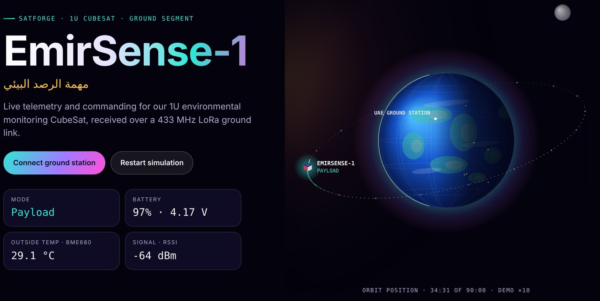
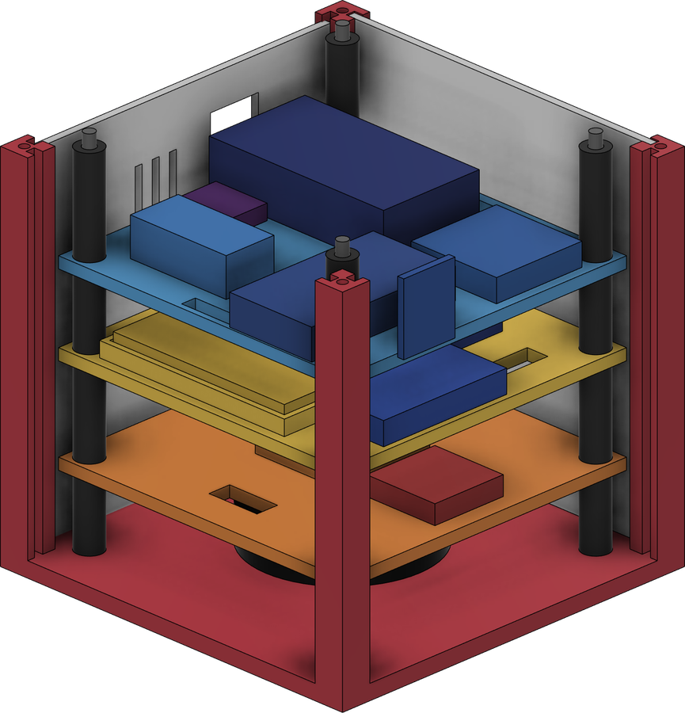
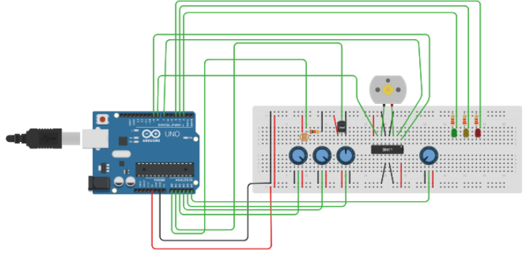

<div align="center">


# EmirSense-1

**1U Environmental Monitoring CubeSat · SatForge Competition, UAE**

مهمة الرصد البيئي

[](https://emirsense-1.vercel.app/dashboard/)
[](https://emirsense-1.vercel.app)
[](LICENSE)



</div>

---

## About the mission

EmirSense-1 is a 3D-printed 1U CubeSat technology demonstrator. It is designed to:

- sense its environment with a **BME680** payload (temperature, humidity, pressure, gas)
- monitor spacecraft health (battery power, internal temperature, sunlight)
- stabilize its attitude with a **reaction wheel**
- store data on board on **MicroSD**
- send telemetry and receive commands over a **433 MHz LoRa** link

This repository holds the project website and the **mission control dashboard** used for the ground segment.

## Mission control dashboard

**▶ [Open the live dashboard](https://emirsense-1.vercel.app/dashboard/)**: it starts in simulation mode, so it works without any hardware.

| Feature | What it does |
|---|---|
| Live orbit view | The CubeSat flies around Earth at its real orbit phase, dims in eclipse and links to the UAE ground station during passes |
| CONOPS timeline | 90-minute orbit bar with the current mode, next mode and countdown |
| Payload | BME680 temperature, humidity, pressure and gas with live charts |
| Power & thermal | INA219 battery, voltage, current, power; DHT11 inside vs BME680 outside temperature |
| Attitude | 3D cube driven by MPU6050 roll, pitch and spin rate; reaction-wheel PWM; LDR sun/eclipse |
| Commands | 8 commands with ACK tracking and one automatic resend |
| Demo ×10 | Runs the full orbit in 9 minutes for presentations |
| Event log & CSV | Every packet and command logged; export to CSV from the downloaded copy |

### Connecting the real ground station

1. Flash the ground ESP32 + SX1278 to forward LoRa packets to USB at **115200 baud**.
2. Open the dashboard in **Chrome or Edge** on a laptop.
3. Click **Connect ground station** and choose the ESP32's port.

The packet and command formats are documented in **[docs/telemetry-protocol.md](docs/telemetry-protocol.md)**.

## Concept of operations

| Mode | Duration | Purpose |
|---|---|---|
| Sun Pointing | 30 min | Solar charging and attitude stabilization |
| Payload | 25 min | BME680 collects environmental data |
| Ground Station | 10 min | LoRa telemetry downlink and command uplink |
| Safe / Eclipse | 25 min | Payload and reaction wheel off to save power |

## Spacecraft



- **Structure:** 100 × 100 × 100 mm PETG frame with four corner rails and removable 2 mm side panels
- **Stack:** three removable trays on M3 rods with printed spacers
  - Tray 1 · ADCS: 130 DC motor reaction wheel, MPU6050, TB6612FNG
  - Tray 2 · EPS: 3.7 V 500 mAh LiPo, CN3065, INA219, MT3608
  - Tray 3 · CDHS & sensors: ESP32, SX1278 LoRa, MicroSD, BME680, DHT11
- **Top lid:** recess for the 5 V solar panel, antenna and wire pass-throughs
- **CAD:** Autodesk Fusion 360

<br clear="right">

| Budget | Value | Limit / margin |
|---|---|---|
| Mass | 0.119 kg | 1.33 kg limit · ~1.211 kg margin |
| Power | 2.044 W peak load | 2.20 W generation · +0.156 W (+7.6%) |
| Energy | ~2.017 Wh per orbit | MADAR simulation |

## Simulation



The electronics were first simulated in Tinkercad, with an Arduino standing in for the ESP32, to test payload readings, EPS monitoring, ADCS motor control, thermal sensing and mission-mode switching.

## Repository structure

```
EmirSense-1/
├── index.html                  Project website (front page)
├── dashboard/
│   └── index.html              Mission control dashboard (single file, no build step)
├── assets/                     Renders, screenshots, favicon, social preview image
├── docs/
│   └── telemetry-protocol.md   Packet, command and mode reference
├── vercel.json                 Static hosting config
└── LICENSE
```

## Run locally

No build step or install is needed. The site is static HTML, CSS and JavaScript.

```bash
git clone https://github.com/hussainujjainwala090-debug/EmirSense-1.git
cd EmirSense-1
python3 -m http.server 8000
# open http://localhost:8000
```

For the live USB link, open `dashboard/index.html` directly in Chrome or Edge.

## Deployment

The site is deployed on **Vercel** as a static project, with no framework preset and no build command. Every push to `main` redeploys automatically.

## Team

EmirSense-1 is built by a team of four for the SatForge CubeSat competition.

| Name | Role |
|---|---|
| _Member 1_ | _Role_ |
| _Member 2_ | _Role_ |
| _Member 3_ | _Role_ |
| _Member 4_ | _Role_ |

## License

Released under the [MIT License](LICENSE).
